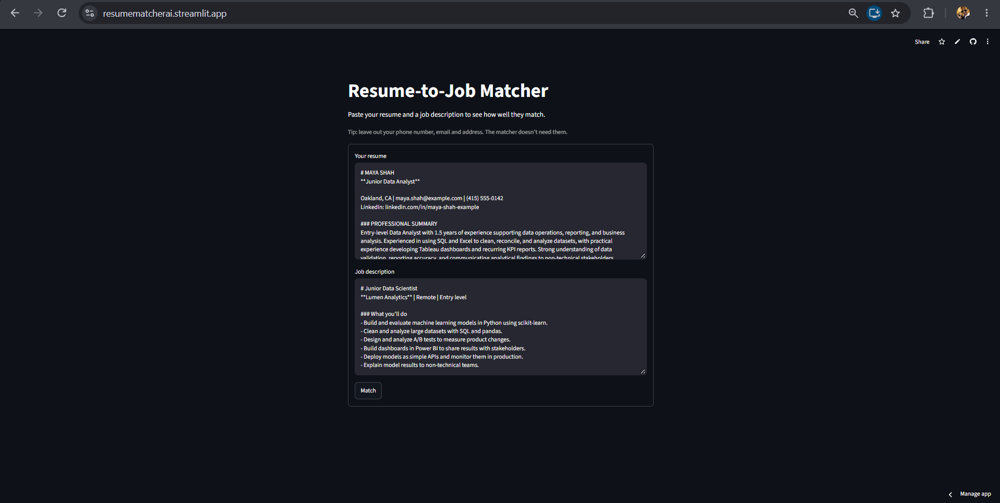
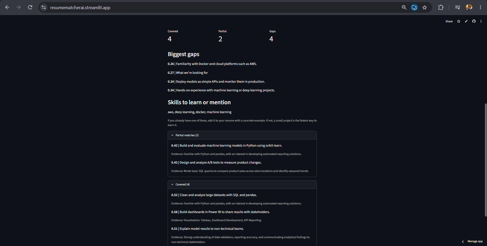

# Resume-to-Job Matcher
**Live demo:** [resumematcherai.streamlit.app](https://resumematcherai.streamlit.app)




An AI tool that compares your resume against a job description and tells you how well you match, which skills you're missing, and what to improve before you apply.

## Why I'm building this

Job applications are a guessing game: you never know what's missing until you get rejected. This tool makes that gap visible before you hit submit. I'm building it to learn applied NLP and take a real AI project from idea to deployment.

## How it will work

1. Paste your resume and a job description
2. The tool converts both into text embeddings and calculates a match score
3. It extracts key skills from the job description and lists the ones missing from your resume
4. It gives suggestions on what to learn or add

## Tech stack (planned)

- Python
- NLP: sentence embeddings for text similarity
- Streamlit for the web interface
- Docker for deployment

## Roadmap

- [x] Week 1: Compare two texts and output a similarity score
- [x] Week 2: Skill extraction and missing-skills list
- [x] Week 3: Streamlit web app and live deployment
- [ ] Week 4: Docker, tests, and write-up

## Status

Just getting started. Building in public, one small commit at a time.

## Run it yourself

**With Python:**
```
pip install -r requirements.txt
streamlit run app.py
```

**With Docker:**
```
docker build -t resume-matcher .
docker run -p 8501:8501 resume-matcher
```
Then open http://localhost:8501. The first Match is slower, because the model downloads once.

## Known limitations

- **Cutoffs are hand-picked.** COVERED (0.50 and up) and PARTIAL (0.35 and up) are starting values, not tuned on a large dataset.
- **Lines that mix several skills get overcredited.** "Python and PyTorch, TensorFlow, Jax" can score as covered when only Python is on the resume.
- **Generic resume sentences attract generic job lines**, which can create false partial matches.
- **Numbers and eligibility rules** (minimum CGPA, graduation year) can't be judged by embeddings.
- **Filters are rule-based.** They only remove pay, location and heading lines that match the word lists.
- **The alias list is hand-made.** Short abbreviations are risky (for example, "CV" can mean curriculum vitae or computer vision).
- **Text only.** No PDF upload, no OCR, no reading jobs from links.
- **Headings without a colon or all caps** can still slip through as requirements, since the filters are word lists.
- **Similar tools count as matches** (for example, Tableau as evidence for Power BI).

## Future work

- Upload resumes as PDF or Word files
- An LLM judge for covered / partial / gap decisions
- A learned classifier to separate requirements from company text
- Read a job description from a URL
- Bake the model into the Docker image for faster startup

## Testing

10 automated tests (pytest) check that the matcher behaves sensibly:

| Test | What it checks | Result |
|---|---|---|
| Alias expansion | "ML" becomes "machine learning" | Pass |
| Label cutoffs | Scores map to COVERED, PARTIAL and GAP correctly | Pass |
| Unrelated job | A cooking job never scores as a strong match | Pass |
| Relevant line | Adding a PyTorch line raises the score | Pass |
| Abbreviation match | "ML" resume line matches a "machine learning" job line | Pass |
| Filters | Headings and pay lines are dropped | Pass |
| Empty job, empty resume, all-filtered job | No crash, returns empty results | Pass |
| Gaps | A gap never shows fake evidence | Pass |

Run them with `python -m pytest -v`.

**Bug found by testing:** empty or fully filtered job text crashed the app. Fixed, and now covered by tests.